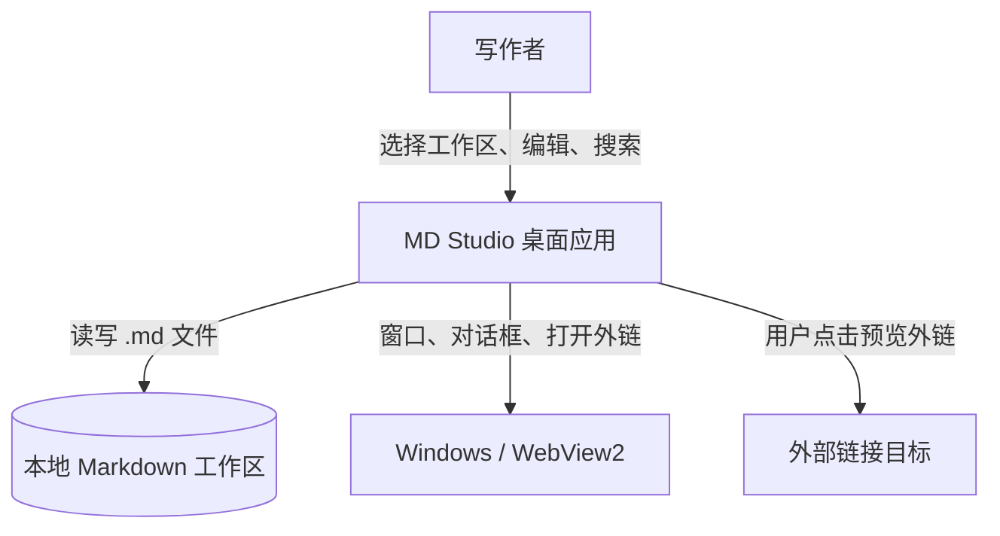

# C1: Context 视图

> C4 Level 1 | 对应 RFC-001 | Updated: 2026-10-23 | 状态：首版，反映 MVP 的系统边界

## 1. 系统边界

MD Studio 是一个本地优先的 Markdown 笔记桌面应用。写作者选择一个本地文件夹作为工作区，在应用内浏览、编辑、预览并自动保存 Markdown 文件。

## 2. 外部参与者与系统

| 参与者/系统 | 关系 |
|---|---|
| 写作者 | 唯一用户角色；拥有本地文件夹的读写权限 |
| 本地 Markdown 工作区 | 任意用户选择的目录；文件系统是唯一事实源（ADR-003） |
| Windows / WebView2 | 提供窗口、原生文件对话框与外链打开能力 |
| 外部链接目标 | 预览中的 http(s) 链接，经系统默认浏览器打开 |

## 3. 关键约束

- 离线可用：除打开外链外，不依赖网络。
- 不持有账号、不做遥测；应用只访问用户显式选择的工作区。
- 单工作区、单窗口、单笔记会话（MVP）。
- 文件访问必须经过 Rust 路径校验，WebView 不直接获得任意读写权限。

## 4. 变更日志

- 2026-10-23 建立 C1，对应 RFC-001 首版。
