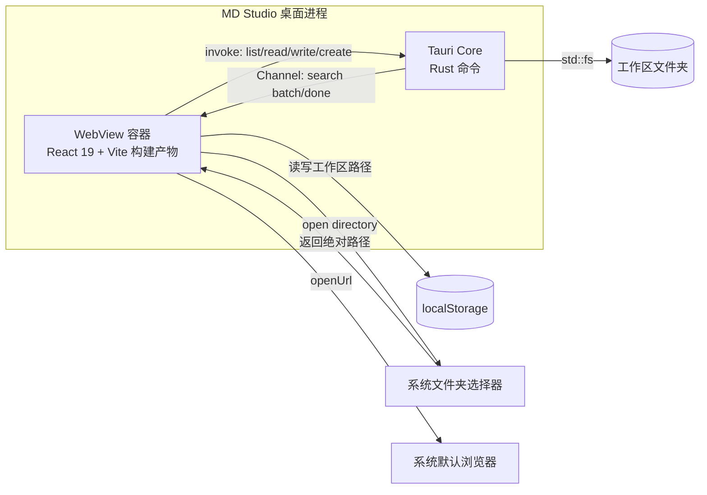

# C2: Container 视图

> C4 Level 2 | 对应 RFC-001 | Updated: 2026-10-23 | 状态：首版，反映 Tauri 双进程容器

## 1. 容器总览

## 2. 容器职责

| 容器 | 技术 | 职责 |
|---|---|---|
| WebView UI | React 19、TypeScript、Vite 8 | 渲染文件树、编辑器、预览；持有会话状态；700ms 防抖触发保存 |
| Tauri Core | Rust 2024、Tauri 2 | 注册命令；扫描目录；校验路径；读写 UTF-8 文件；返回结构化错误 |
| localStorage | WebView 内置 | 仅保存上次工作区根路径，不保存正文 |
| 系统对话框 | `tauri-plugin-dialog` | 选择工作区目录 |
| 系统浏览器 | `tauri-plugin-opener` | 打开预览中的外链 |
| 搜索快照（计划） | Rust 进程内缓存 | 预热、LRU、并行匹配；默认 256 MB；失败回退实时扫描（ADR-007） |
| 文件监听（计划） | `notify` | 递归监听工作区，300 ms 去抖后增量更新快照（ADR-009） |

## 3. 进程与通信

- 单进程、双线程模型由 Tauri 管理；前端与 Rust 通过 JSON 序列化的 `invoke` 通信。
- RFC-006 计划：搜索在 `invoke` 之上叠加 `tauri::ipc::Channel` 流式事件；Rust 侧新增快照缓存与监听线程，均不改变进程边界。
- 命令契约（相对路径 + 工作区根）见 RFC-001 §4.1；错误统一为字符串，前端映射为状态栏提示。
- 不启动本地 HTTP 服务；生产构建的前端资源由 Tauri 内置协议加载。

## 4. 部署与运行时

- Windows 10/11 + WebView2；MSVC 工具链构建。
- 安装包为 NSIS `.exe`，安装后无需 Node/Rust 运行时。
- 开发模式由 Vite 提供 `http://localhost:1420`，`tauri dev` 负责拉起。

## 5. 变更日志

- 2026-10-23 建立 C2；确定「WebView 不直接持有 fs 权限」的容器边界。
- 2026-10-23 RFC-006：规划 Channel 流式搜索、内存快照与 notify 监听；容器数量与权限模型不变。
