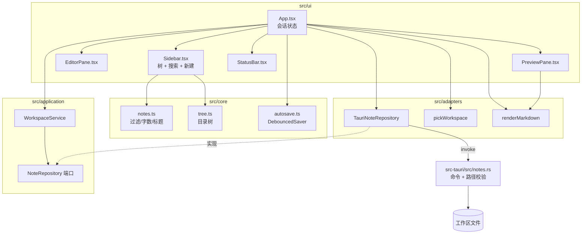

# C3: Component 视图

> C4 Level 3 | 对应 RFC-001 | Updated: 2026-10-23 | 状态：首版，反映 MVP 的域分解与数据流

## 1. 总览图

## 2. 组件详述与追溯

### 2.1 核心域（RFC-001 REQ-002/005，无状态）

| 组件 | 职责 | 文件 |
|---|---|---|
| 笔记模型与查询 | `NoteEntry` 类型、排序、按路径过滤、标题/字数/行数统计 | `src/core/notes.ts` |
| 目录树 | 扁平列表 → 目录优先的有序树；空目录不出现 | `src/core/tree.ts` |
| 防抖保存 | 700ms 合并写入；`flush()` 支持切稿/快捷键 | `src/core/autosave.ts` |

核心域不得 import React、`@tauri-apps/*` 或 DOM API；对应测试为 `*.test.ts`。

### 2.2 应用层（RFC-001 REQ-002/003）

| 组件 | 职责 | 文件 |
|---|---|---|
| `NoteRepository` | 文件能力的端口：`list/read/write/create` | `src/application/ports.ts` |
| `WorkspaceService` | 用例编排：加载、读取、保存、新建；不关心平台 | `src/application/workspace.ts` |

### 2.3 适配器（RFC-001 REQ-001/003/004/006）

| 组件 | 职责 | 文件 |
|---|---|---|
| `TauriNoteRepository` | 把端口方法映射为 `invoke` 命令 | `src/adapters/tauri/noteRepository.ts` |
| `pickWorkspace` | 调系统目录选择器，取消返回 `null` | `src/adapters/tauri/picker.ts` |
| `renderMarkdown` | marked GFM → DOMPurify 清理 | `src/adapters/markdown/render.ts` |

### 2.4 渲染层（RFC-001 REQ-002/005）

| 组件 | 职责 | 文件 |
|---|---|---|
| `App` | 工作区恢复、选择笔记、dirty 状态、视图模式、错误条 | `src/ui/App.tsx` |
| `Sidebar` | 搜索框、目录树、新建输入、刷新 | `src/ui/Sidebar.tsx` |
| `EditorPane` | 受控 textarea、Ctrl+S、Tab 缩进 | `src/ui/EditorPane.tsx` |
| `PreviewPane` | 注入清理后的 HTML、拦截外链 | `src/ui/PreviewPane.tsx` |
| `StatusBar` | 字数、行数、保存状态、相对路径 | `src/ui/StatusBar.tsx` |

### 2.5 Rust 文件边界（RFC-001 REQ-001/003/006）

| 组件 | 职责 | 文件 |
|---|---|---|
| 命令层 | `list_notes` / `read_note` / `write_note` / `create_note` 注册 | `src-tauri/src/lib.rs` |
| 文件域 | 根规范化、相对路径校验、递归扫描、重名去重、5 MiB 限制 | `src-tauri/src/notes.rs` |

## 3. 数据流

### 3.1 打开工作区

1. 用户点击「打开文件夹」→ `pickWorkspace()` 返回绝对路径。
2. `WorkspaceService.list(root)` → `TauriNoteRepository.listNotes` → `invoke('list_notes')`。
3. Rust `canonical_root` → 递归扫描 → 返回 `NoteEntry[]`（相对路径、标题、修改时间）。
4. UI 写入 `localStorage['mdstudio.workspace']`，并用 `buildNoteTree` 渲染目录树。

### 3.2 编辑与保存

1. 点击文件 → `WorkspaceService.read` → Rust 校验路径并读取 UTF-8。
2. textarea `onChange` 更新内容与 dirty 状态，并 `DebouncedSaver.schedule(text)`。
3. 700ms 无输入 → `save` → `invoke('write_note')`；成功后清除 dirty。
4. 切换笔记 / Ctrl+S / 窗口失焦 → `flush()` 立即落盘。

### 3.3 预览

1. `content` 变化 → `renderMarkdown` → `marked.parse` → `DOMPurify.sanitize`。
2. `PreviewPane` 注入 HTML；外链点击被拦截并交给系统浏览器。

## 4. 部署与运行时

- 开发：`bun run tauri dev`（Vite 1420 + Rust debug）。
- 生产：`bun run tauri build` → NSIS 安装包。
- 测试：`bun run test`（core/application/adapters）、`cargo test`（Rust 文件边界）。
- 文档门禁：`node scripts/check-eng-docs.cjs`。

## 5. 追溯矩阵

| RFC / ADR | 组件 | 测试 |
|---|---|---|
| RFC-001 REQ-001/006；ADR-001 | Rust 命令、`TauriNoteRepository` | `src-tauri/src/notes.rs` 单测 |
| RFC-001 REQ-002；ADR-002 | `DebouncedSaver`、`WorkspaceService`、`App` | `src/core/autosave.test.ts`、`src/application/workspace.test.ts` |
| RFC-001 REQ-003 | `create_note`、`Sidebar` | Rust `create_note` 单测 |
| RFC-001 REQ-004 | `renderMarkdown`、`PreviewPane` | `src/adapters/markdown/render.test.ts` |
| RFC-001 REQ-005 | `tree.ts`、`notes.ts`、`Sidebar` | `src/core/tree.test.ts`、`src/core/notes.test.ts` |
| RFC-001 REQ-002/005；ADR-002 | `App`、`Sidebar`、`EditorPane`、`PreviewPane` | `src/ui/App.test.tsx` |

## 6. 变更日志

- 2026-10-23 建立 C3；确定 core/application/adapters/ui 四层与 Rust 文件边界。
- 2026-10-23 MVP 验证：21 个前端测试、7 个 Rust 测试、typecheck、前端构建、NSIS 打包与文档门禁全部通过；组件边界未变。
