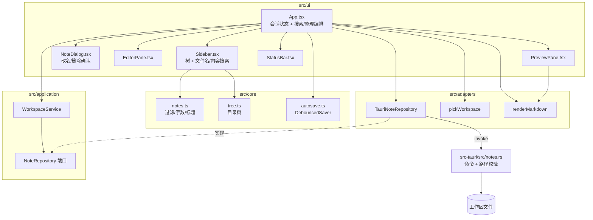

# C3: Component 视图

> C4 Level 3 | 对应 RFC-001、RFC-006 | Updated: 2026-10-25 | 状态：反映 MVP 的域分解；RFC-006 的搜索快照与流式契约已实现，文件监听仍标注为计划态

## 1. 总览图

## 2. 组件详述与追溯

### 2.1 核心域（RFC-001 REQ-002/005；RFC-002 REQ-010，无状态）

| 组件 | 职责 | 文件 |
|---|---|---|
| 笔记模型与查询 | `NoteEntry`、`NoteDocument` 类型、排序、按路径过滤、标题/字数/行数统计 | `src/core/notes.ts` |
| 搜索模型 | `SearchHit` 类型（路径、标题、行号、片段）、`highlightParts` 片段高亮切分 | `src/core/search.ts` |
| 目录树 | 扁平列表 → 目录优先的有序树；空目录不出现 | `src/core/tree.ts` |
| 防抖保存 | 700ms 合并写入；`flush()` 支持切稿/快捷键 | `src/core/autosave.ts` |

核心域不得 import React、`@tauri-apps/*` 或 DOM API；对应测试为 `*.test.ts`。

### 2.2 应用层（RFC-001 REQ-002/003；RFC-002 REQ-008~010）

| 组件 | 职责 | 文件 |
|---|---|---|
| `NoteRepository` | 文件能力的端口：`list/read/write/create/delete/rename/search`；读写携带 revision | `src/application/ports.ts` |
| `WorkspaceService` | 用例编排：加载、读取、条件保存、新建、删除、改名、搜索；不关心平台 | `src/application/workspace.ts` |

### 2.3 适配器（RFC-001 REQ-001/003/004/006；RFC-002 REQ-008~010）

| 组件 | 职责 | 文件 |
|---|---|---|
| `TauriNoteRepository` | 把端口方法映射为 `invoke` 命令 | `src/adapters/tauri/noteRepository.ts` |
| `pickWorkspace` | 调系统目录选择器，取消返回 `null` | `src/adapters/tauri/picker.ts` |
| `renderMarkdown` | marked GFM → DOMPurify 清理 | `src/adapters/markdown/render.ts` |

### 2.4 渲染层（RFC-001 REQ-002/005；RFC-002 REQ-011）

| 组件 | 职责 | 文件 |
|---|---|---|
| `App` | 工作区恢复、选择笔记、dirty/conflict 状态、视图模式、错误条、搜索防抖、删除/改名、撤销 toast、close-request flush | `src/ui/App.tsx` |
| `Sidebar` | 搜索框、目录树、文件名匹配、内容命中（命中词高亮）、新建输入、刷新 | `src/ui/Sidebar.tsx` |
| `NoteDialog` | 重命名输入/删除确认，Escape 取消、Enter 提交 | `src/ui/NoteDialog.tsx` |
| `EditorPane` | 受控 textarea、Ctrl+S、Tab 缩进、按行定位 | `src/ui/EditorPane.tsx` |
| `PreviewPane` | 注入清理后的 HTML、拦截外链 | `src/ui/PreviewPane.tsx` |
| `StatusBar` | 字数、行数、保存/冲突状态、相对路径 | `src/ui/StatusBar.tsx` |

### 2.5 Rust 文件边界（RFC-001 REQ-001/003/006；RFC-002 REQ-008~010）

| 组件 | 职责 | 文件 |
|---|---|---|
| 命令层 | `list_notes` / `read_note` / `write_note` / `create_note` / `delete_note` / `restore_note` / `rename_note` / `search_notes` / `search_cancel` / `snapshot_status` 注册 | `src-tauri/src/lib.rs` |
| 文件域 | 根规范化、相对路径校验、递归扫描（串行枚举 + 并行 stat，≤8 线程）、重名去重、5 MiB 限制、正文行扫描、内容 revision 与条件写入、系统回收站删除与会话内快照恢复 | `src-tauri/src/notes.rs` |
| 搜索引擎 | 内存快照（后台预热、LRU 预算、`Warming/Ready/Degraded`）、并行匹配、整篇扫描、片段生成；`SearchEvent` 流式（Batch ≤16 / 唯一 Done / `request_id` 取消）；监听待 Task 6 | `src-tauri/src/search.rs` |
| 文件监听（计划） | notify 递归监听、300 ms 去抖、增量更新快照与降级状态 | `src-tauri/src/watcher.rs` |

## 3. 数据流

### 3.1 打开工作区

1. 用户点击「打开文件夹」→ `pickWorkspace()` 返回绝对路径。
2. `WorkspaceService.list(root)` → `TauriNoteRepository.listNotes` → `invoke('list_notes')`。
3. Rust `canonical_root` → 递归扫描 → 返回 `NoteEntry[]`（相对路径、标题、修改时间）。
4. UI 写入 `localStorage['mdstudio.workspace']`，并用 `buildNoteTree` 渲染目录树。

### 3.2 编辑与保存

1. 点击文件 → `WorkspaceService.read` → Rust 校验路径并读取 UTF-8。
2. textarea `onChange` 更新内容与 dirty 状态，并 `DebouncedSaver.schedule(text)`。
3. 700ms 无输入 → `save` → `invoke('write_note')`；成功后清除 dirty。
4. 切换笔记 / 切换工作区 / Ctrl+S / 关闭窗口 → `flush()` 立即落盘。

### 3.3 预览

1. `content` 变化 → `renderMarkdown` → `marked.parse` → `DOMPurify.sanitize`。
2. `PreviewPane` 注入 HTML；外链点击被拦截并交给系统浏览器。

### 3.4 删除与重命名

1. 删除：工具栏 → `NoteDialog` 确认 → `saver.cancel()` → `invoke('delete_note')`；Rust 读取文本快照后把文件移入系统回收站，返回 `{ path, content }`。
2. 删除后：刷新列表、关闭当前笔记，并显示「已移入系统回收站」toast；`content` 非空时可点「撤销」恢复。
3. 改名：工具栏 → 对话框输入 → `flush()` → `invoke('rename_note')` → 刷新列表 → `openNote(updated)` 重建 saver。

### 3.5 全文搜索

现状（RFC-006 Task 5：流式与取消已实现）：

1. 查询变化 → 自适应防抖（快照 `Ready`：≤2,000 篇 80 ms，更多 120 ms；`Warming/Degraded` 200 ms）→ `WorkspaceService.search(root, query, requestId, onBatch)`；适配器创建 `Channel` 并 `invoke('search_notes')`。
2. Rust 优先在内存快照上并行扫描（打开工作区后在后台预热）；快照未就绪、条目被淘汰、超限或非 UTF-8 时逐篇回退读盘，结果与顺序不变。
3. 每批 ≤16 条经 Channel 送达；`Sidebar` 每批用 `mergeHits` 追加、去重并按路径稳定排序。最后一个 `Done` 携带总数、是否截断、耗时与来源（内存快照/实时扫描/部分快照），渲染为状态行。
4. 查询变化或清空时，effect 清理函数调用 `search_cancel(requestId)`；Rust 的 `request_id` 单调递增，工作线程在批次边界检查并退出，前端同时丢弃迟到批次。
5. `Sidebar` 同时渲染文件名树与内容命中；`highlightParts(preview, query)` 把命中词切分为 `<mark>`；点击命中调用 `openNote(note, line)`，`EditorPane` 定位到行。

RFC-006 剩余（未实现）：监听（`watcher.rs`）增量更新快照；失败置 `Degraded`，查询前 mtime+size 校验（Task 6）。

### 3.6 关闭前 flush

1. 用户点击窗口关闭 → `onCloseRequested` 阻止默认关闭。
2. `flushCurrent()` 等待 `DebouncedSaver.flush()`；成功则 `window.close()`，失败/冲突则保持窗口并显示错误。
3. `closingRef` 放行第二次 close 事件，避免死循环。

### 3.7 外部修改冲突

1. 打开笔记 → Rust 返回 `{ content, revision }`；前端写入 `revisionRef`。
2. 保存 → `invoke('write_note', { content, expectedRevision })`；Rust 重新读取磁盘并比较 revision。
3. 不一致 → `conflict:` 错误；UI 暂停自动保存，显示重新载入/覆盖保存。
4. 重新载入替换本地稿；覆盖保存用最新 revision 写入并更新 `revisionRef`。

### 3.8 撤销删除

1. 删除返回的 `DeletedNote.content` 只保存在 App 内存；切换工作区或再次删除会替换它。
2. 点「撤销」→ `invoke('restore_note', { path, content })`；Rust 拒绝已存在的目标路径并重新校验工作区边界。
3. 成功后刷新列表并 `openNote(restored)` 重新读取 revision；toast 关闭。
4. 8 秒无操作后 toast 自动消失，撤销入口结束；更早的文件由系统回收站找回。

### 3.9 搜索快照与失效（RFC-006 Task 4/5 已实现；监听待 Task 6）

1. 打开工作区：`list_notes` 返回后后台预热，`snapshot_status` 进入 `Warming`，64 篇一批读入，不阻塞编辑；预算满即停。
2. 查询：快照命中走内存并行扫描；未就绪、被淘汰、超限或非 UTF-8 回退读盘。应用内写/新建/删除/改名/恢复同步镜像快照。
3. 失效：notify 事件 300 ms 去抖后增量更新；监听失败置 `Degraded`；手动刷新全量对账。**当前外部编辑要等 Task 6 才能被快照感知。**
4. 取消：`request_id` 单调递增，工作线程每批检查，前端丢弃迟到批次。
5. 边界：快照只读；保存仍读盘比对 revision（ADR-005），删除/恢复/重命名语义不变。

## 4. 部署与运行时

- 开发：`bun run tauri dev`（Vite 1420 + Rust debug）。
- 生产：`bun run tauri build` → NSIS 安装包。
- 测试：`bun run test`（core/application/adapters）、`cargo test`（Rust 文件边界）。
- 文档门禁：`node scripts/check-eng-docs.cjs`。

## 5. 追溯矩阵

| RFC / ADR | 组件 | 测试 |
|---|---|---|
| RFC-001 REQ-001/006；ADR-001 | Rust 命令、`TauriNoteRepository` | `src-tauri/src/notes.rs` 单测 |
| RFC-001 REQ-002；ADR-002 | `DebouncedSaver`、`WorkspaceService`、`App` | `src/core/autosave.test.ts`、`src/application/workspace.test.ts` |
| RFC-001 REQ-003 | `create_note`、`Sidebar` | Rust `create_note` 单测 |
| RFC-001 REQ-004 | `renderMarkdown`、`PreviewPane` | `src/adapters/markdown/render.test.ts` |
| RFC-001 REQ-005 | `tree.ts`、`notes.ts`、`Sidebar` | `src/core/tree.test.ts`、`src/core/notes.test.ts` |
| RFC-001 REQ-002/005；ADR-002 | `App`、`Sidebar`、`EditorPane`、`PreviewPane` | `src/ui/App.test.tsx` |
| RFC-002 REQ-008/009；ADR-003 | `delete_note`、`rename_note`、`NoteDialog` | Rust 单测、`src/ui/App.test.tsx` |
| RFC-002 REQ-010；ADR-004 | `search_notes`、`SearchHit`、`Sidebar` | Rust 单测、`src/ui/App.test.tsx` |
| RFC-003 REQ-013/016；ADR-005 | `onCloseRequested`、`flushCurrent`、`StatusBar` | `src/ui/App.test.tsx` |
| RFC-003 REQ-014/015；ADR-005 | `NoteDocument`、`revision_for_bytes`、`write_note` | Rust 单测、`src/application/workspace.test.ts` |
| RFC-004 REQ-017/019；ADR-006 | `DeletedNote`、`delete_note_with`、`restore_note` | Rust 单测、`src/ui/App.test.tsx` |
| RFC-004 REQ-018；ADR-006 | `handleUndoDelete`、UndoToast、`NoteDialog` | `src/ui/App.test.tsx` |
| RFC-005 REQ-020；ADR-004 | `highlightParts`、`hit-mark`、`Sidebar` | `src/core/search.test.ts`、`src/ui/App.test.tsx` |
| RFC-005 REQ-021；ADR-004 | `search_notes_blocking` 大工作区耗时 | Rust 单测 |
| RFC-006 REQ-022~025；ADR-007 | SearchSnapshot、LRU、预热状态机 | `search.rs` 单测（20 个含快照/预热）+ `bench_search` |
| RFC-006 REQ-026；ADR-008 | `SearchEvent` 流式契约、`search_cancel`、`request_id` | `search.rs` 契约测试（批次上限、唯一 Done、取消）+ `noteRepository.test.ts` + `App.test.tsx` |
| RFC-006 REQ-027；ADR-009 | Watcher、mtime 兜底、手动对账 | 计划：临时目录集成测试 |
| RFC-006 REQ-028~030 | 50k 上限、侧栏虚拟化、基准门禁 | 计划：50k 基准 + UI 测试 |

## 6. 变更日志

- 2026-10-23 建立 C3；确定 core/application/adapters/ui 四层与 Rust 文件边界。
- 2026-10-23 MVP 验证：21 个前端测试、7 个 Rust 测试、typecheck、前端构建、NSIS 打包与文档门禁全部通过；组件边界未变。
- 2026-10-23 RFC-002：新增 `NoteDialog`、`SearchHit`、Rust 删除/改名/搜索命令；`NoteRepository` 端口扩展，分层方向不变。
- 2026-10-23 RFC-002 验证：前端 27 passed、Rust 12 passed、typecheck/build/NSIS 1.51 MiB/docs PASS；搜索采用 Rust 实时扫描（ADR-004）。
- 2026-10-23 RFC-003：`read_note` 返回 `NoteDocument`，`write_note` 条件写入；App 增加 close-request flush 与冲突横幅。
- 2026-10-23 RFC-003 验证：前端 28 passed、Rust 15 passed、typecheck/build/docs PASS；`core:window:allow-close` 已加入能力清单。
- 2026-10-23 RFC-004：`delete_note` 改为系统回收站并返回内容快照，新增 `restore_note`；App 增加撤销 toast。
- 2026-10-23 RFC-004 验证：前端 30 passed、Rust 21 passed、typecheck/build/NSIS 1.52 MiB/docs PASS；系统回收站调用在单测中用闭包替换。
- 2026-10-23 RFC-005：内容命中片段高亮查询词；新增 1,000 篇笔记的 Rust 搜索耗时回归测试。
- 2026-10-23 RFC-005 验证：前端 36 passed、Rust 22 passed、1,001 篇搜索实测 330.97ms、typecheck/build/NSIS 1.52 MiB/docs PASS。
- 2026-10-23 RFC-006：搜索计划改为「内存快照 + 并行 + Channel 流式」，新增 `search.rs` / `watcher.rs` 规划，`MAX_NOTES` 目标 50k 并配套侧栏虚拟化；当前代码尚未实现。
- 2026-10-24 RFC-006 L2：`search.rs` 新增只读快照（预热、LRU 预算、三态）与 `snapshot_status` 命令；查询优先读快照、逐篇回退读盘；写/删/改名/恢复同步镜像；ASCII needle 改为整篇扫描。前端与监听/流式仍未接入（Task 5/6）。
- 2026-10-24 RFC-006 L0/L1：`search.rs` 承载匹配与片段生成（L0）并按块并行扫描（L1，`std::thread::scope`、≤8 线程）；`notes.rs` 的扫描拆为串行枚举 + 并行 stat。分层与命令契约未变。
- 2026-10-24 RFC-006 L0/L1 验证：Rust 27 passed、`check:perf` PASS（1k 415.5→83.7 ms）；内存快照、流式与监听仍未实现。
