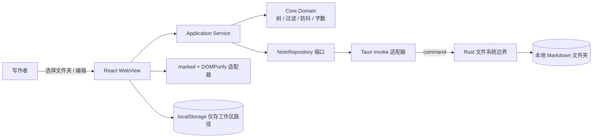

# RFC-001: MD Studio 本地 Markdown 笔记桌面应用（MVP）

> Status: Implemented (Completed 2026-10-23) | Type: RFC | Created: 2026-10-23 | Updated: 2026-10-23 | Authors: Buffy | Reviewers: 项目所有者 | Target: v0.1.0
> 索引：`RFC-001` | 关联 REQ：REQ-001~REQ-007 | 收益：把「选文件夹 → 编辑 → 预览 → 自动保存」的本地写作闭环压缩到一次启动内完成，核心逻辑可离线单测。
> 位置：`docs/rfc/RFC-001-md-studio-mvp.md` 权威；`docs/specs/2026-10-23-md-studio-mvp-design.md` 为实现快照
> 一致性声明：本文档与 ADR-001（Tauri 外壳）、ADR-002（端口/适配器分层）、ADR-003（文件系统即事实源）保持一致；后续变更需先更新本文档再改代码。

## 0. 更新摘要

2026-10-23：建立首份 RFC。目标是用一个足够小、但边界完整的桌面应用，示范「领域逻辑可测、平台能力可替换、文档先行」的持续演进基线。本期只做单工作区、单笔记编辑、GFM 预览、自动保存、文件树与搜索；同步、协作、插件、数据库均明确列为非目标。

2026-10-23：MVP 实现完成并通过验证：前端 21 个测试、Rust 7 个测试、`typecheck`、前端构建、NSIS 安装包（1.50 MiB）与文档门禁全部通过。

## 1. 需求

| REQ | 能力 | 基线 | 目标 | 验证 |
|---|---|---|---|---|
| REQ-001 | 选择本地文件夹并递归列出 Markdown 文件 | 0（脚手架只有 `greet` 命令，`src-tauri/src/lib.rs:2`） | 最多 12 层，识别 `.md/.markdown/.mdown`，跳过隐藏目录与 `node_modules/target` | `cd md-studio && cargo test list_notes` 与 `bun run test` |
| REQ-002 | 打开、编辑、700ms 防抖自动保存，Ctrl+S 立即保存 | 0（`src/App.tsx` 为 Tauri 计数器示例） | 切换笔记前先 flush，保存失败保留 dirty 状态并提示 | `cd md-studio && bun run test autosave` |
| REQ-003 | 新建笔记并对重名自动去重 | 0 | 非法字符替换为 `-`，同名追加 `-2`、`-3`，不覆盖已有文件 | `cd md-studio && cargo test create_note` |
| REQ-004 | GFM 实时预览并清除危险 HTML | 0 | 标题/列表/表格/代码块可渲染，`<script>`、`onerror` 等被移除 | `cd md-studio && bun run test render` |
| REQ-005 | 目录树展示与按路径搜索 | 0 | 目录优先排序，搜索大小写不敏感，命中数量可见 | `cd md-studio && bun run test tree` |
| REQ-006 | 阻止目录穿越与越界读写 | 0 | `..`、绝对路径、非 Markdown 扩展名、根目录逃逸全部拒绝 | `cd md-studio && cargo test path` |
| REQ-007 | 产出 Windows 可安装桌面程序 | 0 | `tauri build` 成功，生成 NSIS 安装包 | `cd md-studio && bun run tauri build` |

## 2. 现状根因

- `src-tauri/src/lib.rs:2` 只注册了 `greet`，没有任何文件系统命令；前端无法访问本地笔记。
- `src/App.tsx:1` 是 create-tauri-app 的演示页，没有工作区、笔记或保存概念。
- `src-tauri/tauri.conf.json:13` 的窗口标题仍是 `md-studio`，产品名与标识符未按最终应用配置。
- 项目没有测试、类型检查脚本和文档门禁，无法支撑「持续维护进化」的目标。

## 3. 总体设计



三条边界：

1. **UI 不直接调用 `invoke`**：只依赖 `application` 层暴露的服务与端口，便于用内存假实现测试。
2. **Rust 是唯一文件系统边界**：所有路径在 Rust 侧规范化、校验并限制在工作区根内，前端不持有任意读写能力。
3. **文件系统是唯一事实源**：不建数据库、不缓存正文；启动时重新扫描，外部编辑器改动不会被陈旧索引覆盖。

## 4. 详细设计

### 4.1 工作区扫描与笔记模型（REQ-001、REQ-003、REQ-006）

Rust 侧 `src-tauri/src/notes.rs`（由 `lib.rs` 注册命令）：

```rust
#[derive(Serialize)]
#[serde(rename_all = "camelCase")]
pub struct NoteEntry {
    pub path: String,      // 相对工作区根，统一使用 '/'
    pub name: String,      // 文件名
    pub title: String,     // 去掉 .md 后缀
    pub modified_ms: Option<u64>,
}
```

- `canonical_root` 只接受存在的目录，后续所有比较都以 `fs::canonicalize` 结果为准。
- `relative_note_path` 只允许 `Component::Normal` 与 `.`，拒绝 `..`、根路径和盘符；扩展名白名单为 `md/markdown/mdown`。
- 读已存在文件时对目标 `canonicalize` 并检查 `starts_with(root)`；写新文件时对父目录做同样检查，防止符号链接逃逸。
- 单文件上限 5 MiB，目录深度上限 12，扫描上限 5000 条，避免误选巨型目录时卡死。

### 4.2 编辑会话与自动保存（REQ-002）

`src/core/autosave.ts` 提供与框架无关的 `DebouncedSaver`：

```ts
const saver = new DebouncedSaver(700, (text) => workspace.save(root, path, text))
saver.schedule(text)   // 每次输入重置计时器
await saver.flush()    // 切换笔记 / Ctrl+S / 关闭前
```

- 打开另一篇笔记前必须 `flush()`，否则最后一次防抖窗口内的输入会丢失。
- 保存失败时不清除 dirty 标记，状态栏显示错误，下一次输入继续重试。
- 采用「最后一次写入获胜」，不做文件冲突检测（见 backlog B1-4）。

### 4.3 预览渲染（REQ-004）

`src/adapters/markdown/render.ts` 用 `marked`（GFM、`breaks: true`）生成 HTML，再交给 DOMPurify 白名单清理；UI 通过 `dangerouslySetInnerHTML` 注入清理后的结果。预览中的外链由点击拦截并交给 Tauri opener，不在 WebView 内导航。

### 4.4 文件树与搜索（REQ-005）

`src/core/tree.ts` 把扁平 `NoteEntry[]` 构造为目录树：目录在前、文件在后，各自按名称排序；空目录不生成节点。`src/core/notes.ts` 的 `filterNotes` 对 `path` 做大小写不敏感匹配，搜索只影响展示，不改变当前打开笔记。

### 4.5 渲染层（REQ-002、REQ-005）

`src/ui/App.tsx` 持有会话状态（工作区、笔记列表、当前笔记、dirty、视图模式），`Sidebar`/`EditorPane`/`PreviewPane`/`StatusBar` 只接收 props。`localStorage` 仅保存 `mdstudio.workspace`，恢复失败时清空并回到空态页。

## 5. 错误处理与可观测性

| 失败模式 | 处理 |
|---|---|
| 文件夹无权限 / 已被删除 | Rust 返回可读错误，UI 顶部显示错误条，保留当前编辑内容 |
| 单文件超过 5 MiB | 拒绝读取并提示，不进入编辑器 |
| 保存失败 | dirty 标记保留，状态栏显示 `保存失败`，下次输入或 Ctrl+S 重试 |
| 预览含危险 HTML | DOMPurify 清理；不渲染 script/事件属性 |
| 路径越界 | Rust 返回 `path escapes workspace`，UI 仅展示错误，不重试 |

日志：MVP 使用 `console.error` 与状态栏文本，不引入遥测；Rust panic 由 Tauri 默认处理。

## 6. 验收

实现完成后回填真实命令输出与测试数量。

| REQ | 验收结果 |
|---|---|
| REQ-001 | `cargo test`：7 passed（含 `list_notes` 递归/跳过隐藏）；`bun run test`：21 passed |
| REQ-002 | `DebouncedSaver` 4 个单测覆盖合并、flush、失败重试、cancel；`App` DOM 测试覆盖打开笔记与预览 |
| REQ-003 | Rust：重名 `Hello-World.md` / `Hello-World-2.md`、空标题回退 `untitled.md` 均通过 |
| REQ-004 | `render.test.ts`：标题/列表/表格/代码块渲染通过；`<script>` 与 `onerror` 被移除 |
| REQ-005 | `tree.test.ts` 3 个、`notes.test.ts` 7 个、`App.test.tsx` 搜索过滤均通过 |
| REQ-006 | Rust：`../`、绝对路径、非 Markdown 扩展名均被拒绝（2 个测试） |
| REQ-007 | `bun run tauri build` 成功；产物 `src-tauri/target/release/bundle/nsis/MD Studio_0.1.0_x64-setup.exe`（1.50 MiB） |

## 7. 非目标

- 不做云同步与多人协作：需要账号、冲突合并与服务端，超出学习型 MVP。
- 不做数据库索引：文件系统已是事实源，索引会引入一致性与迁移成本。
- 不做所见即所得（WYSIWYG）：MVP 用「源码 + 预览」验证渲染边界，编辑器内核留待后续 ADR。
- 不做插件系统：先稳定端口与命令契约，再谈扩展点。
- 不做移动端：Tauri 桌面壳先跑通，移动端差异另行评估。

## 8. 追溯

本目录尚未初始化 Git，因此没有提交集与分支可登记（按用户要求未执行提交）。

- 实现位置：`md-studio/src/{core,application,adapters,ui}`、`src-tauri/src/{lib,notes}.rs`
- 新增测试：`src/core/{notes,tree,autosave}.test.ts`、`src/application/workspace.test.ts`、`src/adapters/markdown/render.test.ts`、`src/ui/App.test.tsx`、`src-tauri/src/notes.rs` 内嵌单测
- 最终结果：前端 6 个测试文件 / 21 passed；Rust 7 passed；`bun run typecheck`、`bun run build`、`bun run tauri build`、`bun run check:docs` 均成功

> 实现追溯：无提交集（not a git worktree）；验收数据采集于 2026-10-23，环境 Windows x64 + MSVC + WebView2。
