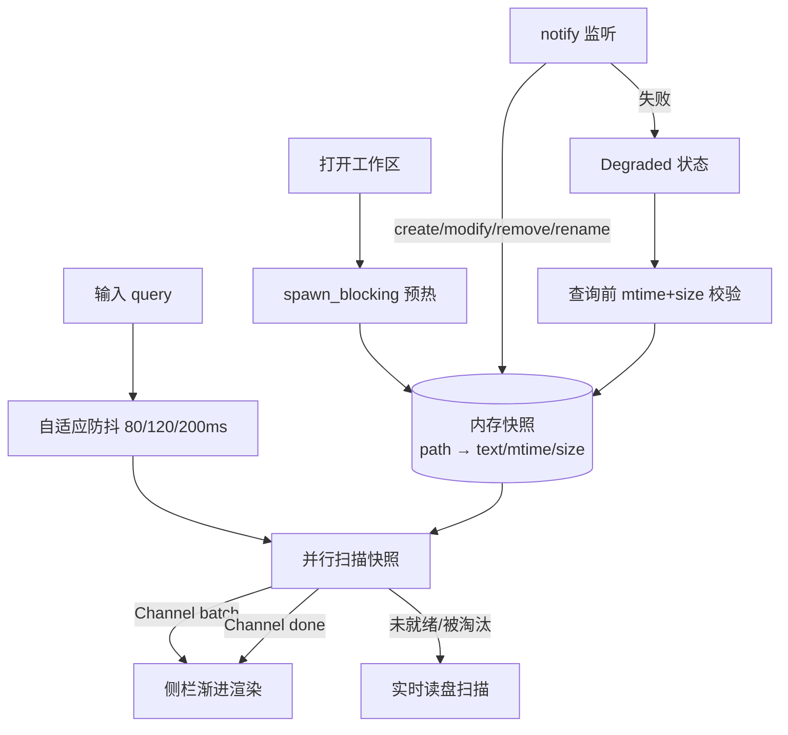

# RFC-006: 搜索性能重构（内存快照、流式契约与 50k 规模）（域 Search）

> Status: Draft | Type: RFC | Created: 2026-10-23 | Updated: 2026-10-23 | Authors: Buffy | Reviewers: 项目所有者 | Target: v0.6.0
> 索引：`RFC-006` | 关联 REQ：REQ-022~REQ-030 | 收益：10k 工作区暖查询 p95 ≤20 ms，50k 可打开可搜索，搜索延迟从「随文件数线性劣化」变成可验收的指标
> 位置：本文档为权威方案；需求与决策快照见 `docs/specs/2026-10-23-search-performance-design.md`

一致性声明：与 ADR-003（文件系统唯一事实源）、ADR-005（内容 revision 并发）、ADR-006（回收站与撤销）兼容；ADR-004（实时扫描、不建索引）由 **ADR-007** 取代。本 RFC 不改变保存、冲突、删除、恢复与重命名的语义，只改变读路径与搜索契约。

## 0. 更新摘要

2026-10-23：建立 RFC-006。RFC-005 只给搜索加了一条 1,001 篇的 10 s 回归护栏；实测 1,001 篇 release 313 ms，且 debug 与 release 只差 6%，说明瓶颈是每次查询重扫磁盘而非计算。本 RFC 把搜索重构为「打开工作区后台预热的内存快照 + 并行扫描 + Channel 流式返回」，并把 `MAX_NOTES` 提升到 50,000 配套侧栏虚拟化。

## 1. 需求

| REQ | 能力 | 基线 | 目标 | 验证 |
|---|---|---|---|---|
| REQ-022 | L0 扫描热点优化 | release 313 ms @1k；每行 `to_lowercase` 分配；排序在比较函数里现算 | 同语料下降 ≥10%，匹配语义（大小写、中文、片段）完全不变 | `cargo test` + `scripts/bench-search.mjs` |
| REQ-023 | L1 并行扫描 | 串行逐篇扫描 | 1k 档 ≤120 ms（release，本机）；命中集合与串行逐条一致 | 基准 + 黄金结果比对 |
| REQ-024 | L2 内存快照与 LRU | 每次查询全量读盘 | 10k 档暖查询 p95 ≤20 ms；预算默认 256 MB、可配置；超预算 LRU 淘汰 | 基准 + 快照单测 |
| REQ-025 | 后台预热与状态机 | 无预热概念 | 打开工作区即后台预热、不阻塞 UI；`Warming/Ready/Degraded` 可见；失败回退实时扫描 | 集成测试 + App 测试 |
| REQ-026 | 流式搜索契约 | 一次性 `SearchHit[]`，旧结果只能丢弃 | Channel 逐批返回 + `Done` 汇总；支持取消；旧一次性命令退役 | Rust 契约测试 + 前端 mock |
| REQ-027 | 监听失效与兜底 | 外部修改搜索不可见 | 外部编辑 500 ms 内可见；监听失败时查询前 mtime+size 校验 | 临时目录集成测试 |
| REQ-028 | 50k 上限与树虚拟化 | `MAX_NOTES` 10,000；全量 DOM | 50,000 篇可打开、可搜索；侧栏虚拟化；键盘与无障碍不回归 | 50k 基准 + UI 测试 |
| REQ-029 | 自适应防抖与首屏 | 固定 250 ms，是感知延迟硬下限 | 80/120/200 ms 三档；首屏 p95 ≤100 ms @10k | App 测试 + 手动计时 |
| REQ-030 | 基准与回归门禁 | 单个 10 s 护栏，无法发现逐步劣化 | 1k/10k/50k 三档基准；分机器基线；中位数 ≤1.2×、p95 ≤2× | 脚本 + 基线 JSON |

SLO 明细与口径见 spec §3；本表只列验收边界。

## 2. 现状根因

- `search_notes_blocking`（`src-tauri/src/notes.rs:500`）每次查询都调用 `list_notes` 重新遍历目录，再对每篇笔记 `resolve_existing`（`canonicalize` + `is_file`）后 `read_to_string`。
- 1,001 篇约 0.32 MB 正文，release 313.01 ms、debug 330.97 ms（§spec 2.2）。debug 只慢 6%，证明耗时在文件系统调用而非字符串处理。
- 逐行 `line.to_lowercase().contains(...)` 为每一行分配新字符串；`build_preview` 对命中行再做一次 `Vec<char>` 全行拷贝。
- 前端固定 250 ms 防抖（`src/ui/App.tsx:291`），即使后端降到毫秒级，感知下限仍是 250 ms。
- 命中上限 50 条、每篇 3 条（`notes.rs:11-12`），无分页、无流式，常见词的结果会被静默截断。

## 3. 总体设计



不变量：

1. 快照是**只读缓存**，不是事实源；磁盘永远优先（ADR-003）。
2. 保存、冲突、删除、恢复、重命名语义不变；`write_note` 仍读盘比对 revision（ADR-005）。
3. 搜索永远不阻塞 UI 线程；重活只在 `spawn_blocking` 或专用线程池。
4. 任何缓存失效、监听失败或取消，都只能降低速度，不能改变结果。
5. 搜索接口只暴露 `SearchHit { path, title, line, preview }`；前端高亮逻辑不需要知道数据来自快照还是磁盘。

## 4. 详细设计

### 4.1 模块划分

```text
src-tauri/src/search.rs        快照、LRU、匹配、预览、并行与取消（pub API，可被 bin 复用）
src-tauri/src/watcher.rs       notify 监听、事件去抖、快照增量更新
src-tauri/src/notes.rs         文件边界命令；搜索命令改为薄封装，转发 Channel 事件
src-tauri/src/bin/bench_search.rs  独立基准入口（release）
```

`lib.rs` 注册新命令并持有 `SearchState`（快照表 + 最新请求号）。把搜索从 `notes.rs` 抽出的目的是让基准与命令共享同一实现，避免「测的和跑的不是一份代码」。

### 4.2 L0 热点优化（REQ-022）

| 改动 | 细节 |
|---|---|
| 排序 key 预计算 | `list_notes` 先为每篇算 `(lower_path, path)`，再 `sort_by_cached_key`；消除每次比较两次分配 |
| ASCII 快路径 | 全 ASCII needle 用 `aho-corasick` 的 `ascii_case_insensitive(true)`，不逐行 `to_lowercase` |
| Unicode 回退 | 非 ASCII needle 保留 `to_lowercase` 语义，中文与大小写折叠行为与现状一致 |
| 片段按需 | 只对命中行生成 preview；用 `char_indices` 找字符边界，替代 `Vec<char>` |
| 搜索路径去 canonicalize | 路径来自 `walk` 产出的相对路径且 `walk` 已跳过符号链接；搜索直接 `root.join(relative)`，canonicalize 留在 read/write/delete 边界 |
| 早停 | 命中计数达到上限立即返回，不再继续读文件 |

预期：计算部分 2–4×，墙钟 10–20%（I/O 主导）。L0 可独立上线，作为 L2 的对照组。

### 4.3 L1 并行（REQ-023）

- 按笔记切块，`rayon` 或 `std::thread::scope` 并行；线程数 `min(available_parallelism, 8)`。
- 全局命中上限用原子计数或「线程局部收集 + 主线程截断」，两种实现都必须保证不超过 50 条。
- 顺序：L1 单独上线时按路径排序后返回，保持与现状一致；接入流式后由 §4.5 的批次语义接管。

### 4.4 L2 内存快照（REQ-024 / REQ-025）

```rust
struct Snapshot {
    root: PathBuf,
    state: SnapshotState,          // Warming | Ready | Degraded
    notes: HashMap<PathBuf, CacheEntry>,
    bytes: usize,
    generation: u64,
}

struct CacheEntry {
    title: String,
    mtime_ms: u64,
    size: u64,
    text: Arc<str>,
    last_used: u64,
}
```

- **预热**：工作区打开成功后立即 `spawn_blocking`，按 64 篇一批读入；每批更新进度并通过 `snapshot_status` 暴露。预热期间搜索走实时扫描，不等待。
- **预算**：默认 256 MB，可由设置项或 `MDSTUDIO_SEARCH_CACHE_MB` 覆盖；插入超预算时按 `last_used` 淘汰，直到低于水位。淘汰只影响性能。
- **查询**：持读锁把目标条目克隆为 `Arc<str>`，释放锁后并行扫描，避免长时间占用写锁。
- **单篇上限**：仍受 `MAX_FILE_BYTES = 5 MiB` 约束；超限或非 UTF-8 的笔记不进入快照，永远走实时读盘。
- **清理**：切换工作区时丢弃整个快照；应用退出不持久化。

### 4.5 流式契约（REQ-026）

```rust
#[derive(Clone, serde::Serialize)]
#[serde(tag = "kind", rename_all = "camelCase")]
pub enum SearchEvent {
    Batch { hits: Vec<SearchHit> },
    Done { total: u32, truncated: bool, took_ms: u32, source: SearchSource },
}

#[tauri::command]
pub async fn search_notes(
    root: String,
    query: String,
    request_id: u64,
    on_event: tauri::ipc::Channel<SearchEvent>,
) -> AppResult<()>;

#[tauri::command]
pub fn search_cancel(request_id: u64);
```

- 旧的一次性 `search_notes` 退役；前端、测试、文档同步迁移。
- `request_id` 单调递增；Rust 保存最新值，工作线程每批检查一次，过期立即退出。
- `search_cancel` 用于清空查询与切换工作区；取消不保证「零批次」，前端按 `request_id` 丢弃迟到事件。
- 每批最多 16 条；`Done` 只发一次，包含总数、是否截断、耗时与数据来源。
- 前端端口改为 `searchNotes(root, query, onBatch): Promise<SearchSummary>`；适配器负责 `new Channel<SearchEvent>()`。

### 4.6 监听与失效（REQ-027）

- `notify` 递归监听工作区，只处理 `.md/.markdown/.mdown` 与目录事件，隐藏目录、`node_modules`、`target`、`dist`、`build` 继续忽略。
- 事件去抖 300 ms 后合并处理：`create/modify` 重读该文件，`remove` 删条目，`rename` 删旧键插新键。
- 监听初始化失败、事件溢出或连续读失败 → `Degraded`；查询前对命中的笔记做 mtime+size 校验，不一致则重读并更新。
- 手动刷新执行全量对账：重新遍历并重建快照。
- 原子保存（临时文件 + rename）依赖 rename/create 事件；集成测试必须覆盖该路径。

### 4.7 50k 与侧栏虚拟化（REQ-028）

- `MAX_NOTES` 改为 50,000；目录深度上限仍为 12。
- 侧栏改为固定行高窗口化（24 px、overscan 20、`ResizeObserver`），只渲染视口内节点；目录默认折叠，搜索过滤只渲染匹配项。
- 保留 `tree/treeitem` 角色、`aria-expanded` 与方向键导航；虚拟化后必须有测试覆盖。
- `list_notes` 一次性 IPC 传输 50k 条（约 5–8 MB JSON）；先实测打开耗时，超过 2 s 再引入按目录懒加载（B4-7 子项）。

### 4.8 自适应防抖与首屏（REQ-029）

| 条件 | 防抖 |
|---|---|
| 快照 `Ready` 且笔记 ≤2,000 | 80 ms |
| 快照 `Ready` 且笔记 >2,000 | 120 ms |
| `Warming` 或 `Degraded` | 200 ms |

- 每批到达后对当前 ≤50 条按路径稳定排序再渲染，`Done` 不重排。
- 首屏 p95 目标 = 防抖 + 首批扫描 ≤100 ms（10k 档）。

### 4.9 依赖选型

| 依赖 | 用途 | 结论 |
|---|---|---|
| `aho-corasick` | ASCII 大小写不敏感字面匹配 | 采用（L0） |
| `rayon` | 并行扫描 | 采用；若体积或构建时间不可接受，退回 `std::thread::scope` |
| `notify` | 文件监听 | 采用（ADR-009） |
| `tantivy` / `grep-searcher` | 倒排索引 / ripgrep 内核 | 本次不采用，留给 ADR-010 |

版本在实现时锁定并写入 `Cargo.toml`；新增依赖必须在 plan 的验证步骤中检查构建产物体积变化（NSIS 当前 1.52 MiB）。

## 5. 错误处理与可观测性

| 场景 | 处理 |
|---|---|
| 快照预热中 | 搜索走实时扫描；UI 显示「预热中 n/N」；不报错 |
| 条目被淘汰 | 单篇回退读盘；结果不变；状态不降级 |
| 监听初始化失败/溢出 | 置 `Degraded`；查询前 mtime 校验；UI 提示「实时扫描」 |
| Channel 关闭（窗口卸载） | Rust 侧写事件失败即退出任务；不 panic |
| 取消后仍有批次到达 | 前端按 `request_id` 丢弃 |
| 文件非 UTF-8 或 >5 MiB | 不进入快照；实时扫描时跳过该文件（与现状一致） |
| 工作区被删除/不可读 | 预热失败 → `Degraded`；搜索返回现有错误；提示重新选择工作区 |

可观测性：`snapshot_status` 返回 `{ state, total, cached, bytes, degradedReason }`；状态栏展示缓存大小与来源。不引入遥测、日志上报或持久化指标。

## 6. 验收

| REQ | 验收方式 | 当前状态 |
|---|---|---|
| REQ-022 | 1k 基准 ≥10% 提升；匹配语义用例全绿 | **通过 2026-10-23**：暖 p50 1k −30.1%、10k −28.9%、50k −26.6%；`aho-corasick` ASCII 匹配、按需片段、排序 key 预计算、搜索路径去 canonicalize；Rust 26 passed |
| REQ-023 | 1k ≤120 ms；与串行结果逐条一致 | 待实现（plan Task 3） |
| REQ-024 | 10k 暖查询 p95 ≤20 ms；LRU 单测 | 待实现（plan Task 4） |
| REQ-025 | 打开工作区不阻塞；三态可见；失败降级 | 待实现（plan Task 4） |
| REQ-026 | Channel 契约测试；旧命令移除；取消无副作用 | 待实现（plan Task 5） |
| REQ-027 | 临时目录外部修改 500 ms 内可见；监听失败降级 | 待实现（plan Task 6） |
| REQ-028 | 50k 可打开可搜索；树虚拟化；键盘/无障碍用例 | 待实现（plan Task 7） |
| REQ-029 | App 测试覆盖 80/120/200 ms 选择；首屏计时 | 待实现（plan Task 5） |
| REQ-030 | 三档基准可复现；基线 JSON；1.2×/2× 判定 | **通过 2026-10-23**：基线入库；`check-search-perf.mjs` 按中位数 ≤1.2×、p95 ≤2× 判定，PASS/FAIL 自检均通过；基准不进 CI |

验收前必须跑：`bun run test`、`bun run typecheck`、`bun run build`、`cargo test --locked --all-targets`、`bun run tauri build`、`node scripts/check-eng-docs.cjs`。性能数字一律以 release 为准，并记录机器档位（spec §10.3）。

## 7. 非目标

- 正则、模糊匹配、相关性排序：ADR-010 评估。
- 持久化索引、SQLite FTS、跨会话缓存：与 ADR-003 冲突，不做。
- 编辑器内命中高亮与跳转选中：textarea 限制，另立 RFC。
- 多标签、多窗口、协作同步。
- 跨平台验证矩阵：仍只保证 Windows；其他平台另开条目。
- 遥测与远端性能监控。

## 8. 追溯

- 需求与决策快照：`docs/specs/2026-10-23-search-performance-design.md`（Q1~Q10 已裁决）
- 决策记录：ADR-007（快照缓存，取代 ADR-004）、ADR-008（流式契约）、ADR-009（文件监听）；ADR-010 预留
- 实现计划：`docs/plans/2026-10-23-search-performance-plan.md`
- Backlog：`docs/backlog.md` B4-1~B4-9
- 架构视图：C2（容器依赖）、C3（新增 Snapshot/Watcher/Channel 组件）
- 实现落点：`src-tauri/src/search.rs`、`src-tauri/src/watcher.rs`、`src-tauri/src/notes.rs`、`src-tauri/src/bin/bench_search.rs`、`src/adapters/tauri/noteRepository.ts`、`src/application/{ports,workspace}.ts`、`src/ui/{App,Sidebar}.tsx`
- 文档：`README.md`、`knowledge.md`
- 状态：本 RFC 为 Draft，代码尚未实现；实现完成后回填 §6 与本节。
